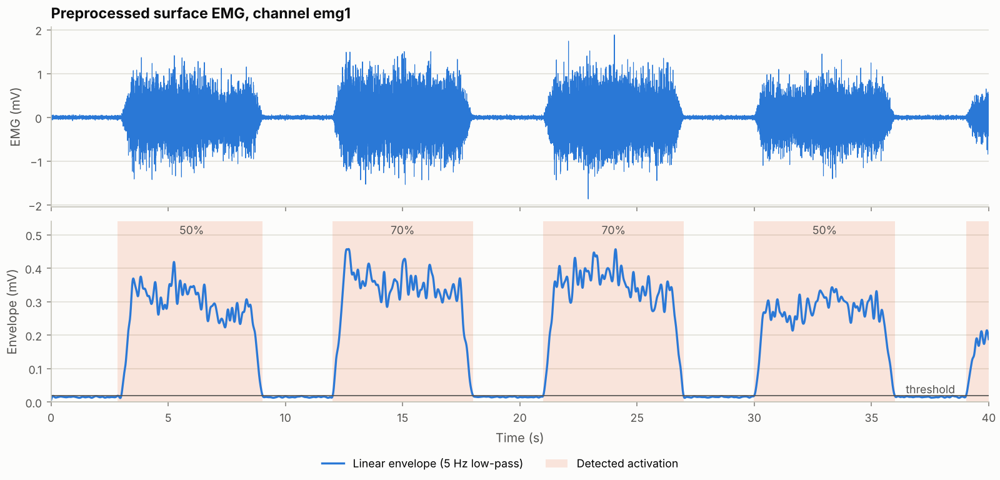

# biosigkit

**From raw EMG / EEG / force recordings to a tidy feature table, an honest cross-subject accuracy and a SQL database.**

[](https://github.com/juanbezerra1/biosigkit/actions/workflows/ci.yml)


*Leia em português: [README.pt-BR.md](README.pt-BR.md)*

biosigkit is a small, typed and tested Python toolkit for the unglamorous part of biosignal projects:
cleaning recordings the same way every time, turning them into tidy tables, validating classifiers
without fooling yourself, and keeping the results in a database you can query with SQL. It ships with a
synthetic-data generator and an end-to-end demo, so everything in this README runs **without any real
recordings**.


*Synthetic cohort: 8 subjects, 192 trials, 4 force levels (chance = 25 %). With a random
split, trials of the same subject end up in both the training and the test set. Leaving whole subjects out
is the honest estimate, and z-scoring each subject's features removes the gain differences between subjects.*

## The problems it addresses

- **Between-subject variability dominates.** Electrode placement, skin impedance and effort change the scale
  of EMG/EEG features more than the effect you are looking for.
- **Random train/test splits leak.** When trials of one subject sit on both sides, the model can learn *who*
  the subject is instead of *what* they did, and the accuracy is optimistic.
- **Mains interference differs between recordings** (50 vs 60 Hz, harmonics, strength). It must be handled the
  same way for everyone, and what was done must be written down.
- **Feature tables rot.** Scripts plus spreadsheets cannot be queried, audited or joined with metadata.

## What is inside

| Area | What you get |
| --- | --- |
| Signal container | Immutable `Signal` (channels × samples, `fs`, `t0`, metadata) with `crop`, `pick`, `to_frame`, `from_frame` |
| Filtering | Zero-phase Butterworth band/low/high-pass, IIR notch, detrend, rational polyphase resampling |
| Preprocessing | Declarative `PreprocessConfig`, `EMG_PRESET` / `EEG_PRESET`, **automatic 50/60 Hz detection** (with harmonics) that survives strong muscle activity, provenance stored in `signal.meta["preprocess"]` |
| EMG | Linear envelope, moving RMS, %MVC normalisation, MAV / RMS / WL / ZC / SSC / VAR / iEMG / MNF / MDF, threshold-based activation detection |
| EEG | Welch PSD, band powers, common-average reference, ERD %, peak-to-peak epoch rejection |
| Force | Time in range, longest run in range, tracking error, steadiness (CV) |
| Tables | Window- and trial-level feature tables with `<channel>_<feature>` columns, label-by-overlap, long/wide conversion, summaries, validation |
| Machine learning | LOSO, group k-fold and (for contrast) naive k-fold; scaling fitted inside each fold; within-subject z-score; LDA / SVM / random forest / logistic regression; scenario comparison |
| SQL | SQLite schema (subjects → recordings → segments → features), parameterised queries, six teaching queries (window functions, CTEs, gaps-and-islands, ...) |
| Command line | `biosigkit demo \| features \| evaluate \| sql` |
| Synthetic data | Force-matching EMG with inter-subject variability, trial-to-trial gain drift and mains interference; EEG with task-related alpha desynchronisation |

## Install

```bash
git clone https://github.com/juanbezerra1/biosigkit
cd biosigkit
pip install -e ".[dev]"      # Python >= 3.10
```

## Quickstart

```python
import pandas as pd

from biosigkit import EMG_PRESET, compare_scenarios, make_cohort, preprocess, trial_feature_table
from biosigkit.tables import infer_feature_columns

# 1. A small simulated cohort: 6 subjects, 4 force levels (10/30/50/70 % MVC), 4 trials each.
cohort = make_cohort(n_subjects=6, trials_per_level=4, seed=1)

# 2. Preprocess every recording (detrend -> mains notch -> 20-450 Hz band-pass) and extract one
#    row of features per trial. The first second of every trial (the force ramp) is trimmed.
tables = []
for session in cohort:
    emg = preprocess(session.emg, EMG_PRESET)
    print(f"{session.subject}: notch applied at {emg.meta['preprocess']['notch_applied_hz']} Hz")
    tables.append(
        trial_feature_table(emg, session.events, trim_s=1.0, meta={"subject": session.subject})
    )
trials = pd.concat(tables, ignore_index=True)
features = infer_feature_columns(trials)
print(f"\n{len(trials)} trials x {len(features)} features, e.g. {features[:3]}\n")

# 3. Compare validation schemes. A random split can let the model recognise the subject
#    (optimistic); leaving whole subjects out (LOSO) is the honest estimate; z-scoring within
#    subject removes the scale differences between subjects.
results = compare_scenarios(trials, features, "label", "subject", models=("lda", "rf"))
print(results[["model", "scheme", "normalization", "accuracy"]].round(3).to_string(index=False))
```

Output:

```text
S01: notch applied at [60.0, 120.0] Hz
S02: notch applied at [60.0, 120.0] Hz
S03: notch applied at [60.0, 120.0] Hz
S04: notch applied at [60.0, 120.0] Hz
S05: notch applied at [60.0, 120.0] Hz
S06: notch applied at [60.0, 120.0] Hz

96 trials x 10 features, e.g. ['emg1_mav', 'emg1_rms', 'emg1_wl']

model scheme normalization  accuracy
  lda  kfold          none     0.396
   rf  kfold          none     0.562
  lda   loso          none     0.417
   rf   loso          none     0.438
  lda   loso  within_group     0.885
   rf   loso  within_group     0.917
```

With only 96 trials these numbers are noisy (the random split is not always above LOSO); the point is the jump once
features are z-scored within each subject. The `demo` command below uses twice as many trials.

Or run the whole pipeline from the shell (about 10 seconds; it writes a report, figures, CSVs and a database):

```bash
biosigkit demo --out demo_output
```

## What the demo shows

Force-level classification (10 / 30 / 50 / 70 % of a maximum) from trial-level EMG features. Accuracy by
validation scheme, 192 trials from 8 simulated subjects:

| Model | Random split (leaky) | Leave-one-subject-out | LOSO + within-subject z-score |
| --- | ---: | ---: | ---: |
| LDA | 0.391 | 0.359 | **0.839** |
| Linear SVM | 0.573 | 0.484 | **0.833** |
| RBF SVM | 0.573 | 0.568 | **0.818** |
| Random forest | 0.646 | 0.604 | **0.818** |

- A random split is more optimistic than leaving subjects out for every model (by 0.5 to
  8.9 percentage points here, because the simulated subjects differ mostly by a gain factor). With real
  data the gap can be much larger; `tests/test_ml.py` builds an extreme case on purpose.
- Within-subject z-scoring is what makes cross-subject classification work in this simulation
  (+21 to +48 points over plain LOSO).
- **Caveat:** within-subject z-scoring uses the *unlabelled* features of the held-out subject (a calibration
  block, in practice). It is transductive; do not read it as a model that never saw the new subject.

Other results from the same run (synthetic data, so these check the code, not physiology):

- Threshold-based activation detection: 192/192 contractions found, 0 false positives, median onset
  latency 0.01 s.
- Mains interference (60 Hz and its harmonic) detected in every simulated subject.
- Simulated alpha desynchronisation recovered as C3 −75 %, Cz −55 %, C4 −33 %.
- A SQL gaps-and-islands query recovers exactly the simulated number of contractions from the window-level table.




## Design decisions

- **Immutable signals, recorded provenance.** Every operation returns a new `Signal`. `preprocess` writes what
  it did (detected mains frequencies, sampling rates) into `meta`, and `register_recording` stores it as JSON next to the data.
- **Zero-phase filtering.** `sosfiltfilt` avoids phase distortion, which matters for onset timing. The price is
  non-causality: this is for offline analysis, not for real-time control.
- **Line-noise detection that survives contractions.** It keeps a low quantile of the spectrogram over time
  instead of the mean: mains interference is stationary, EMG bursts are not. A test runs it on simulated
  recordings with and without interference and requires zero misses and zero false alarms.
- **Tidy tables with a naming convention.** Columns are `<channel>_<feature>` and feature names may not contain
  an underscore, so wide and long formats convert losslessly.
- **Leakage-aware validation by default.** LOSO and group k-fold assert that no subject appears on both sides of
  a split, and scalers are fitted inside each training fold. Naive k-fold exists only to quantify the optimism.
- **SQL as a first-class output.** Features go to a long table (`segment_id`, `channel`, `feature`, `value`), NaN
  becomes `NULL`, values are always bound as parameters (never pasted into SQL text), and `biosigkit sql run` opens
  the database read-only.

## SQL

```text
subjects 1──* recordings 1──* segments 1──* features
                              (window | trial,  (channel, feature, value)
                               t_start, t_stop, label)
```

| Query | What it practises |
| --- | --- |
| `mean_rms_by_label` | a three-table `JOIN`, `GROUP BY`, aggregate functions |
| `within_subject_minmax` | CTEs, window functions (`MIN` / `MAX` / `PERCENT_RANK() OVER`), a named `WINDOW`, `NULLIF` |
| `activation_episodes` | the gaps-and-islands pattern: two `ROW_NUMBER()` windows, chained CTEs |
| `top_trials_per_subject` | top-N per group: `ROW_NUMBER() OVER (PARTITION BY ...)` filtered through a CTE |
| `data_quality` | an aggregate of an aggregate, `CASE`, class-balance flags |
| `missing_values` | boolean arithmetic in aggregates (`SUM(value IS NULL)`), computed percentages |

```bash
biosigkit sql list
biosigkit sql show activation_episodes
biosigkit sql run demo_output/biosigkit_demo.sqlite --example top_trials_per_subject
biosigkit sql run demo_output/biosigkit_demo.sqlite -q "SELECT feature, COUNT(*) FROM features GROUP BY feature"
```

## Command line

| Command | Purpose |
| --- | --- |
| `biosigkit demo [--subjects N] [--trials-per-level N] [--seed S] [-o DIR]` | Full pipeline on synthetic data: report, figures, CSVs, SQLite database |
| `biosigkit features SIGNAL.csv [--events EVENTS.csv] [--mode window\|trial] [--kind emg\|eeg]` | Preprocess a recording and write a feature table (`--fs` or `--time-col` gives the sampling rate) |
| `biosigkit evaluate FEATURES.csv [--model lda\|svm_rbf\|svm_linear\|rf\|logreg] [--scheme loso\|group_kfold\|kfold] [--normalize]` | Cross-validate without subject leakage and print metrics and a confusion matrix |
| `biosigkit sql list \| show NAME \| run DB (-e NAME \| -q "SELECT ...")` | Bundled and ad-hoc SQL |

Signal CSVs have one column per channel; event CSVs have `onset`, `offset` and `label` (seconds).

## Project layout

```text
src/biosigkit/
├── signals.py      immutable Signal container
├── filters.py      band/low/high-pass, notch, detrend, resample
├── preprocess.py   PreprocessConfig, presets, automatic line-noise detection
├── emg.py  eeg.py  force.py        signal-specific features
├── windowing.py    sliding windows, event tables, epochs
├── tables.py       tidy feature tables, long/wide, summaries
├── ml.py           leakage-aware cross-validation, within-subject z-score
├── storage.py      SQLite schema, save/load, parameterised queries
├── sql/            schema.sql and the six teaching queries
├── synthetic.py    simulated sessions and cohorts
├── viz.py          figures (matplotlib Figure API, colour-blind-safe palette)
└── demo.py  cli.py  __main__.py
tests/              pytest suite, one file per module
examples/           quickstart.py (the snippet above)
docs/img/           figures used in this README
```

## Development

```bash
pip install -e ".[dev]"
pytest --cov=biosigkit
ruff check . && ruff format --check .
mypy src
```

CI runs the tests on Python 3.10 to 3.13, lint and types, and builds the wheel and runs the demo from a clean
environment. The suite also passes with the oldest supported versions of the dependencies.

## Scope and limitations

- Everything here is **simulated**. The numbers verify that the code does what it claims; they say nothing about
  how well any classifier works on real recordings.
- Not a clinical or medical-device tool.
- Offline analysis only (zero-phase filters are non-causal).
- It does not try to replace [MNE-Python](https://mne.tools) (EEG/MEG analysis) or
  [NeuroKit2](https://neuropsychology.github.io/NeuroKit/) (physiological signal processing). It covers a
  narrower path (raw recording, tidy table, honest validation, SQL) in a few thousand readable lines.
- No participant data belongs in this repository; `.gitignore` excludes common recording formats.

## License

MIT, see [LICENSE](LICENSE). Copyright (c) 2026 Juan de Oliveira Bezerra.
