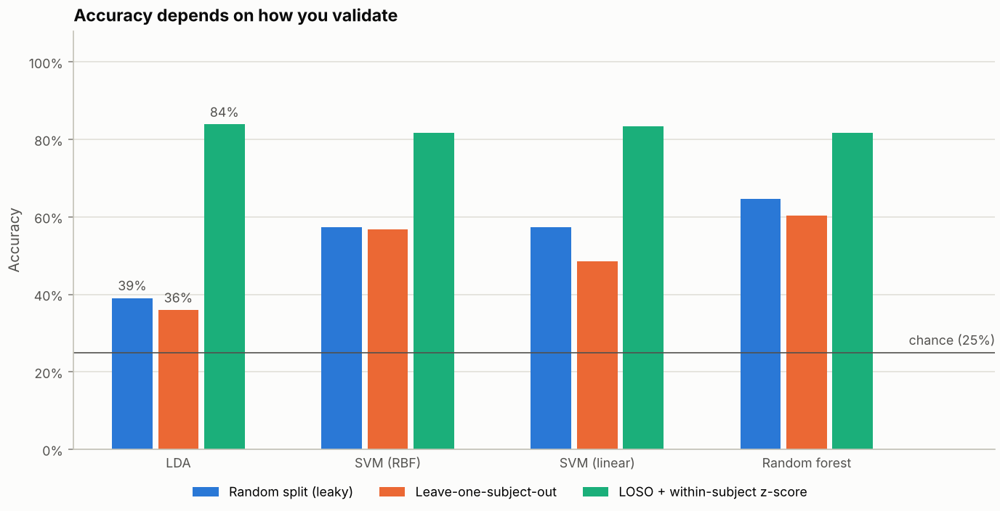
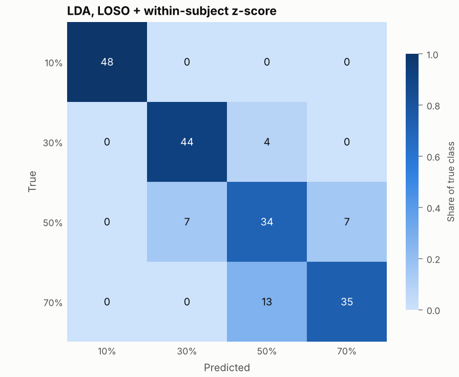
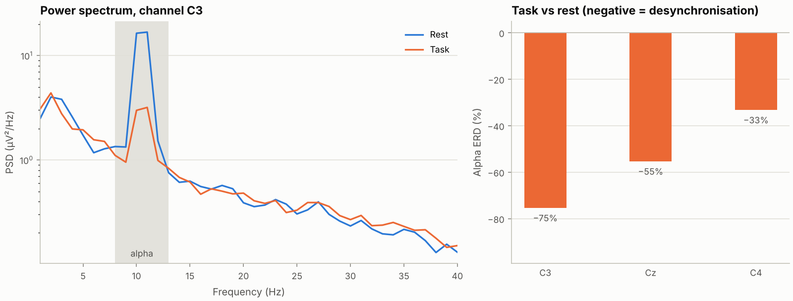
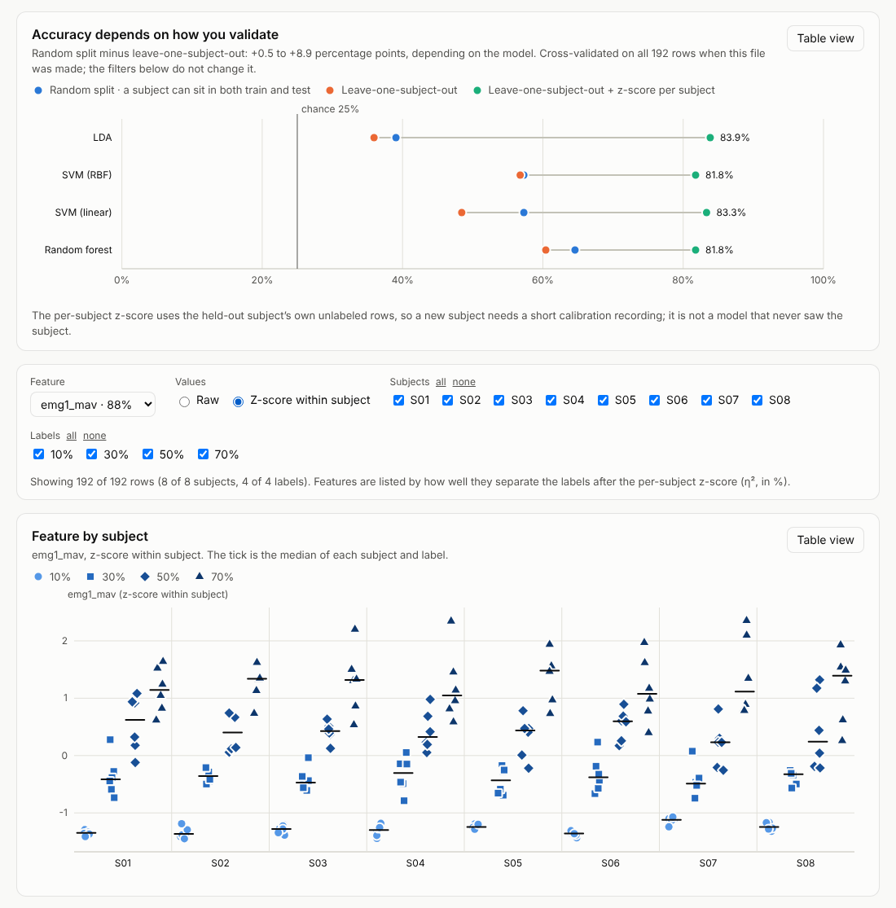

# biosigkit

**From raw EMG / EEG / force recordings to a tidy feature table, an honest cross-subject accuracy and a SQL database.**

[](https://github.com/juanbezerra1/biosigkit/actions/workflows/ci.yml)


*Leia em português: [README.pt-BR.md](README.pt-BR.md)*

biosigkit is a small, typed and tested Python toolkit for the unglamorous part of biosignal projects:
cleaning recordings the same way every time, turning them into tidy tables, validating classifiers
without fooling yourself, and keeping the results in a database you can query with SQL. It ships with a
synthetic-data generator and an end-to-end demo, so everything in this README runs **without any real
recordings**.



*Synthetic cohort: 8 subjects, 192 trials, 4 force levels (chance = 25 %). With a random
split, trials of the same subject end up in both the training and the test set. Leaving whole subjects out
is the honest estimate, and z-scoring each subject's features removes the gain differences between subjects.*

## The problems it addresses

- **Between-subject variability dominates.** Electrode placement, skin impedance and effort change the scale
  of EMG/EEG features more than the effect you are looking for.
- **Random train/test splits leak.** When trials of one subject sit on both sides, the model can learn *who*
  the subject is instead of *what* they did, and the accuracy is optimistic.
- **Mains interference differs between recordings** (50 vs 60 Hz, harmonics, strength). It must be handled the
  same way for everyone, and what was done must be written down.
- **Feature tables rot.** Scripts plus spreadsheets cannot be queried, audited or joined with metadata.

## What is inside

| Area | What you get |
| --- | --- |
| Signal container | Immutable `Signal` (channels × samples, `fs`, `t0`, metadata) with `crop`, `pick`, `to_frame`, `from_frame` |
| Filtering | Zero-phase Butterworth band/low/high-pass, IIR notch, detrend, rational polyphase resampling |
| Preprocessing | Declarative `PreprocessConfig`, `EMG_PRESET` / `EEG_PRESET`, **automatic 50/60 Hz detection** (with harmonics) that survives strong muscle activity, provenance stored in `signal.meta["preprocess"]` |
| EMG | Linear envelope, moving RMS, %MVC normalisation, MAV / RMS / WL / ZC / SSC / VAR / iEMG / MNF / MDF, threshold-based activation detection |
| EEG | Welch PSD, band powers, common-average reference, ERD %, peak-to-peak epoch rejection |
| Force | Time in range, longest run in range, tracking error, steadiness (CV), hold-phase (plateau) window |
| Tables | Window- and trial-level feature tables with `<channel>_<feature>` columns, label-by-overlap, long/wide conversion, summaries, validation |
| Data checks | Per-channel quality report (clipping, flat lines, NaN, mains share of power), trial checks that say *why* a trial was rejected, duplicate recordings found by content hash |
| Machine learning | LOSO, group k-fold and (for contrast) naive k-fold; scaling fitted inside each fold; within-subject z-score; LDA / SVM / random forest / logistic regression; scenario comparison |
| SQL | SQLite schema (subjects → recordings → segments → features), parameterised queries, seven teaching queries (window functions, CTEs, gaps-and-islands, ...) |
| Dashboard | One HTML file to explore a feature table: a feature by subject and by label, raw or z-scored, next to the validation chart; table views, keyboard filters, light and dark |
| Command line | `biosigkit demo \| features \| qc \| duplicates \| export \| dashboard \| evaluate \| sql` |
| Synthetic data | Force-matching EMG with inter-subject variability, trial-to-trial gain drift and mains interference; EEG with task-related alpha desynchronisation |

## Install

```bash
git clone https://github.com/juanbezerra1/biosigkit
cd biosigkit
pip install -e ".[dev]"      # Python >= 3.10
```

## Quickstart

```python
import pandas as pd

from biosigkit import EMG_PRESET, compare_scenarios, make_cohort, preprocess, trial_feature_table
from biosigkit.tables import infer_feature_columns

# 1. A small simulated cohort: 6 subjects, 4 force levels (10/30/50/70 % MVC), 4 trials each.
cohort = make_cohort(n_subjects=6, trials_per_level=4, seed=1)

# 2. Preprocess every recording (detrend -> mains notch -> 20-450 Hz band-pass) and extract one
#    row of features per trial. The first second of every trial (the force ramp) is trimmed.
tables = []
for session in cohort:
    emg = preprocess(session.emg, EMG_PRESET)
    print(f"{session.subject}: notch applied at {emg.meta['preprocess']['notch_applied_hz']} Hz")
    tables.append(
        trial_feature_table(emg, session.events, trim_s=1.0, meta={"subject": session.subject})
    )
trials = pd.concat(tables, ignore_index=True)
features = infer_feature_columns(trials)
print(f"\n{len(trials)} trials x {len(features)} features, e.g. {features[:3]}\n")

# 3. Compare validation schemes. A random split can let the model recognise the subject
#    (optimistic); leaving whole subjects out (LOSO) is the honest estimate; z-scoring within
#    subject removes the scale differences between subjects.
results = compare_scenarios(trials, features, "label", "subject", models=("lda", "rf"))
print(results[["model", "scheme", "normalization", "accuracy"]].round(3).to_string(index=False))
```

Output:

```text
S01: notch applied at [60.0, 120.0] Hz
S02: notch applied at [60.0, 120.0] Hz
S03: notch applied at [60.0, 120.0] Hz
S04: notch applied at [60.0, 120.0] Hz
S05: notch applied at [60.0, 120.0] Hz
S06: notch applied at [60.0, 120.0] Hz

96 trials x 10 features, e.g. ['emg1_mav', 'emg1_rms', 'emg1_wl']

model scheme normalization  accuracy
  lda  kfold          none     0.396
   rf  kfold          none     0.562
  lda   loso          none     0.417
   rf   loso          none     0.438
  lda   loso  within_group     0.885
   rf   loso  within_group     0.917
```

With only 96 trials these numbers are noisy (the random split is not always above LOSO); the point is the jump once
features are z-scored within each subject. The `demo` command below uses twice as many trials.

Or run the whole pipeline from the shell (about 10 seconds; it writes a report, figures, CSVs and a database):

```bash
biosigkit demo --out demo_output
```

## What the demo shows

Force-level classification (10 / 30 / 50 / 70 % of a maximum) from trial-level EMG features. Accuracy by
validation scheme, 192 trials from 8 simulated subjects:

| Model | Random split (leaky) | Leave-one-subject-out | LOSO + within-subject z-score |
| --- | ---: | ---: | ---: |
| LDA | 0.391 | 0.359 | **0.839** |
| Linear SVM | 0.573 | 0.484 | **0.833** |
| RBF SVM | 0.573 | 0.568 | **0.818** |
| Random forest | 0.646 | 0.604 | **0.818** |

- A random split is more optimistic than leaving subjects out for every model (by 0.5 to
  8.9 percentage points here, because the simulated subjects differ mostly by a gain factor). With real
  data the gap can be much larger; `tests/test_ml.py` builds an extreme case on purpose.
- Within-subject z-scoring is what makes cross-subject classification work in this simulation
  (+21 to +48 points over plain LOSO).
- **Caveat:** within-subject z-scoring uses the *unlabelled* features of the held-out subject (a calibration
  block, in practice). It is transductive; do not read it as a model that never saw the new subject.

Other results from the same run (synthetic data, so these check the code, not physiology):

- Threshold-based activation detection: 192/192 contractions found, 0 false positives, median onset
  latency 0.01 s.
- Mains interference (60 Hz and its harmonic) detected in every simulated subject.
- Simulated alpha desynchronisation recovered as C3 −75 %, Cz −55 %, C4 −33 %.
- A SQL gaps-and-islands query recovers exactly the simulated number of contractions from the window-level table.






## Checking the data before modelling

Leave-one-subject-out is only honest if the table it sees is. Four checks, all in the example
`examples/data_checks.py` (it damages a simulated recording on purpose, and a test runs it):

```python
quality = signal_quality(damaged)  # one row per channel
report = check_trials(damaged, session.events, trim_s=1.0)  # one row per trial, with the reason
usable = drop_invalid(session.events, report)  # keeps the original trial numbers
hold = plateau_events(usable, session.force)  # the hold phase, not a fixed trim
copies = find_duplicates({"S01/S1": emg, "S09/S1": copy})  # the same samples under two names
```

```text
  channel  saturated_fraction  nonfinite_fraction  mains_fraction     ok
0    emg1            0.003587            0.000000        0.004772  False
1    emg2            0.000000            0.000333             NaN  False

channel                                 issues
   emg1              0.359% of samples clipped
   emg2 0.0333% of samples are NaN or infinite

 trial label              reason
     3   50%           saturated
     4   70% nonfinite;saturated
     6   70%           saturated

5 usable trials; hold found in 5, median 5.1 s of 6.0 s

    level  n         hash        members
recording  2 17587f2940a6 S01/S1, S09/S1
```

- **`signal_quality`** reports, per channel, the share of NaN / infinite samples, of flat runs (a dropout or an
  unplugged electrode), of samples sitting exactly on the converter's extreme values (clipping), and the share of
  the power that the mains lines carry *above the spectrum around them*. Run it on the **raw** recording: filtering
  smooths clipping away. The limits (`max_saturated`, `max_flat`, `max_mains`) are starting points, not standards.
  Clipping is detected as repeated samples on a channel's extremes, which suits EMG and EEG; a trace that rests
  exactly on its minimum (a force sensor that reads 0 at rest) would be reported too.
- **`check_trials`** says *why* each trial is unusable (`outside_recording`, `too_short`, `nonfinite`, `flat`,
  `saturated`, `no_plateau`), naming the channel. `trial_feature_table(on_invalid="skip")` no longer skips in silence
  either: the rejected trials are in `table.attrs["rejected"]`.
- **`plateau_events`** finds the hold phase of each force trace, so a slow subject does not lose the same second as a
  fast one. It reads the level the trace holds (the median of the middle half of the trial) and keeps the stretch that
  stays at or above 80 % of it, so it assumes the hold fills the middle of the trial. On the simulated cohort
  (192 trials of 6 s) the hold phase has a median of 5.2 s, where a fixed 1 s trim at both ends keeps 4.0 s.
- **`find_duplicates`** hashes the samples (not the file names), so a recording copied under a second subject ID is
  found. That copy is a leak that leave-one-subject-out cannot see: the "held-out" subject also sits in the
  training set. The hash is stored in the database (`recordings.content_sha256`) and the `duplicate_recordings`
  query lists repeats; databases made by 0.1 are upgraded when opened.

From the shell:

```bash
biosigkit qc recording.csv --fs 1000 --strict          # exit status 1 if any channel has an issue
biosigkit duplicates S07.csv S12.csv --fs 1000          # recordings (or channels) that are copies
biosigkit features rec.csv --fs 1000 --events trials.csv --mode trial --trim 1 \
    --check-quality --on-invalid skip --rejected-out rejected.csv
```

## Exploring the table

`biosigkit dashboard` turns a feature table into **one HTML file** (no server, no network, no extra dependency):
one feature at a time, by subject and by label, raw or z-scored within each subject, next to the accuracy each
validation scheme gives. **[Live demo](https://juanbezerra1.github.io/biosigkit/dashboard-demo.html)** (the synthetic
cohort above).



```bash
biosigkit demo --out demo_output                                    # also writes demo_output/dashboard.html
biosigkit dashboard features.csv -o dashboard.html                  # any table with subject, label and numeric columns
biosigkit export demo_output/biosigkit_demo.sqlite -o features.csv  # a database's feature table, as a CSV
```

- Features are ranked by η² after the per-subject z-score (the share of the variance that the label explains). Under
  the charts the page also gives η² for the raw values, which is how you see between-subject differences hiding an effect.
- Every chart has a table view, the filters (feature, raw or z-score, subjects, labels) work from the keyboard, and the
  page follows the system light/dark setting; a button overrides it.
- Three or four labels that look like numbers (`10%`, `20 N`) share one hue and differ in lightness; any other labels
  (up to 8) get distinct hues. Marker shapes differ by label too, so colour is never the only cue.
- The validation chart cross-validates once, when the file is made, and the filters do not change it. That is the slow
  part for big tables: `--models lda` or `--no-validation` skips most or all of it.
- A table of more than 5000 rows is sampled at random (`--max-rows`) and the page says so. From Python:
  `write_dashboard(table, "dashboard.html")`; `dashboard_data` returns the JSON behind the page.

## Design decisions

- **Immutable signals, recorded provenance.** Every operation returns a new `Signal`. `preprocess` writes what
  it did (detected mains frequencies, sampling rates) into `meta`, and `register_recording` stores it as JSON next to the data.
- **Zero-phase filtering.** `sosfiltfilt` avoids phase distortion, which matters for onset timing. The price is
  non-causality: this is for offline analysis, not for real-time control.
- **Line-noise detection that survives contractions.** It keeps a low quantile of the spectrogram over time
  instead of the mean: mains interference is stationary, EMG bursts are not. A test runs it on simulated
  recordings with and without interference and requires zero misses and zero false alarms.
- **Nothing is dropped silently.** A rejected trial, a clipped channel or a duplicated recording is reported with its
  reason, in a table you can save, rather than disappearing from the data.
- **Tidy tables with a naming convention.** Columns are `<channel>_<feature>` and feature names may not contain
  an underscore, so wide and long formats convert losslessly.
- **Leakage-aware validation by default.** LOSO and group k-fold assert that no subject appears on both sides of
  a split, and scalers are fitted inside each training fold. Naive k-fold exists only to quantify the optimism.
- **SQL as a first-class output.** Features go to a long table (`segment_id`, `channel`, `feature`, `value`), NaN
  becomes `NULL`, values are always bound as parameters (never pasted into SQL text), and `biosigkit sql run` opens
  the database read-only.

## SQL

```text
subjects 1──* recordings 1──* segments 1──* features
                              (window | trial,  (channel, feature, value)
                               t_start, t_stop, label)
```

| Query | What it practises |
| --- | --- |
| `mean_rms_by_label` | a three-table `JOIN`, `GROUP BY`, aggregate functions |
| `within_subject_minmax` | CTEs, window functions (`MIN` / `MAX` / `PERCENT_RANK() OVER`), a named `WINDOW`, `NULLIF` |
| `activation_episodes` | the gaps-and-islands pattern: two `ROW_NUMBER()` windows, chained CTEs |
| `top_trials_per_subject` | top-N per group: `ROW_NUMBER() OVER (PARTITION BY ...)` filtered through a CTE |
| `data_quality` | an aggregate of an aggregate, `CASE`, class-balance flags |
| `missing_values` | boolean arithmetic in aggregates (`SUM(value IS NULL)`), computed percentages |
| `duplicate_recordings` | `GROUP BY ... HAVING`, `GROUP_CONCAT` over an ordered subquery, leaving `NULL`s out on purpose |

```bash
biosigkit sql list
biosigkit sql show activation_episodes
biosigkit sql run demo_output/biosigkit_demo.sqlite --example top_trials_per_subject
biosigkit sql run demo_output/biosigkit_demo.sqlite -q "SELECT feature, COUNT(*) FROM features GROUP BY feature"
```

## Command line

| Command | Purpose |
| --- | --- |
| `biosigkit demo [--subjects N] [--trials-per-level N] [--seed S] [-o DIR]` | Full pipeline on synthetic data: report, figures, CSVs, SQLite database |
| `biosigkit features SIGNAL.csv [--events EVENTS.csv] [--mode window\|trial] [--kind emg\|eeg]` | Preprocess a recording and write a feature table (`--fs` or `--time-col` gives the sampling rate). Trial mode also takes `--on-invalid skip`, `--check-quality` and `--rejected-out FILE` |
| `biosigkit qc SIGNAL.csv [--strict] [-o FILE]` | Per-channel quality report; `--strict` exits with status 1 if a channel has an issue |
| `biosigkit duplicates A.csv B.csv ... [--strict]` | Recordings (or channels) that hold exactly the same samples |
| `biosigkit export DB.sqlite [--kind trial\|window] [-o FILE]` | Write the feature table stored in a database to a CSV (input of `evaluate` and `dashboard`) |
| `biosigkit dashboard FEATURES.csv\|DB.sqlite [-o FILE.html] [--labels A,B] [--features X,Y] [--models lda,rf] [--no-validation]` | One self-contained HTML page to explore the table (no server, no network) |
| `biosigkit evaluate FEATURES.csv [--model lda\|svm_rbf\|svm_linear\|rf\|logreg] [--scheme loso\|group_kfold\|kfold] [--normalize]` | Cross-validate without subject leakage and print metrics and a confusion matrix |
| `biosigkit sql list \| show NAME \| run DB (-e NAME \| -q "SELECT ...")` | Bundled and ad-hoc SQL |

Signal CSVs have one column per channel; event CSVs have `onset`, `offset` and `label` (seconds).

## Project layout

```text
src/biosigkit/
├── signals.py      immutable Signal container
├── filters.py      band/low/high-pass, notch, detrend, resample
├── preprocess.py   PreprocessConfig, presets, automatic line-noise detection
├── emg.py  eeg.py  force.py        signal-specific features
├── quality.py  trials.py  duplicates.py    data checks: channels, trials (with reasons), copies
├── windowing.py    sliding windows, event tables, epochs
├── tables.py       tidy feature tables, long/wide, summaries
├── ml.py           leakage-aware cross-validation, within-subject z-score
├── dashboard.py  dashboard.html    one-file page to explore a feature table
├── storage.py      SQLite schema, save/load, parameterised queries
├── sql/            schema.sql and the seven teaching queries
├── synthetic.py    simulated sessions and cohorts
├── viz.py          figures (matplotlib Figure API, colour-blind-safe palette)
└── demo.py  cli.py  __main__.py
tests/              pytest suite, one file per module
examples/           quickstart.py (the snippet above), data_checks.py, build_dashboard_demo.py
docs/               img/ (figures used in this README), dashboard-demo.html (the live demo)
```

## Development

```bash
pip install -e ".[dev]"
pytest --cov=biosigkit
ruff check . && ruff format --check .
mypy src
```

CI runs the tests on Python 3.10 to 3.13 (Linux) and on Python 3.10 and 3.13 (Windows), lint and types, and
builds the wheel and runs the demo from a clean environment on Linux and on Windows. The suite also passes
with the oldest supported versions of the dependencies.

## Scope and limitations

- Everything here is **simulated**. The numbers verify that the code does what it claims; they say nothing about
  how well any classifier works on real recordings.
- Not a clinical or medical-device tool.
- The dashboard is for looking at a table, not for testing anything. Its η² ranking is computed on the rows it
  shows, so do not pick features by it and then validate on the same rows; select inside each training fold.
- Offline analysis only (zero-phase filters are non-causal).
- It does not try to replace [MNE-Python](https://mne.tools) (EEG/MEG analysis) or
  [NeuroKit2](https://neuropsychology.github.io/NeuroKit/) (physiological signal processing). It covers a
  narrower path (raw recording, tidy table, honest validation, SQL) in a few thousand readable lines.
- No participant data belongs in this repository; `.gitignore` excludes common recording formats.

## Related projects

Small, tested companions by the same author. None is required by biosigkit.

- [subjectwise-ml](https://github.com/juanbezerra1/subjectwise-ml): the validation part on its own, for studies with
  a handful of subjects: leakage-free cross-validation, a permutation test that respects the subjects, simulation-based
  power analysis, and an `audit` that also spots a duplicated subject in a feature table.
- [eeg-erds](https://github.com/juanbezerra1/eeg-erds): ERD/ERS, ERP peaks, SOBI blink removal and epoch rejection
  for epoched EEG.
- [experiment-randomizer](https://github.com/juanbezerra1/experiment-randomizer): reproducible, auditable
  randomisation for small experiments (who gets which arm, in which order) with a log that notices edits.

## License

MIT, see [LICENSE](LICENSE). Copyright (c) 2026 Juan de Oliveira Bezerra.
