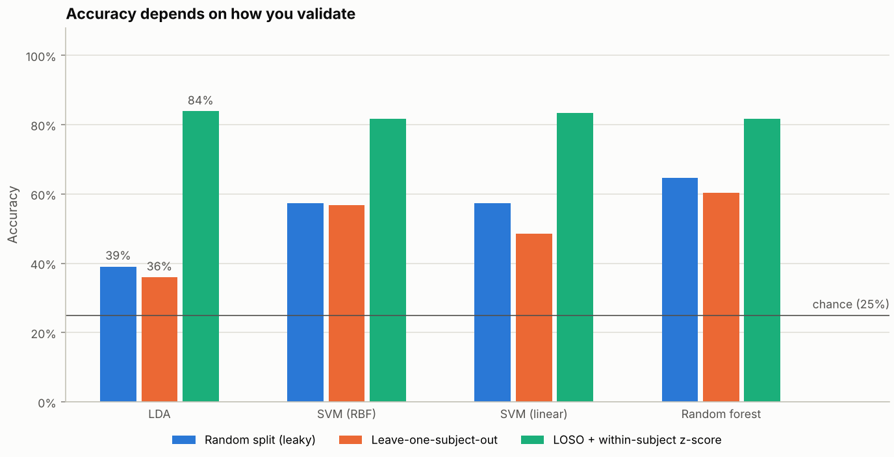
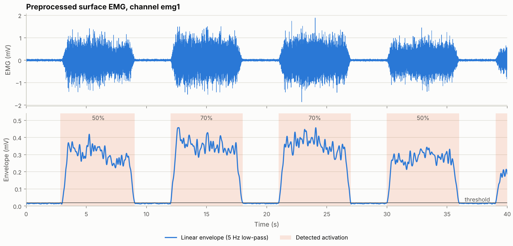
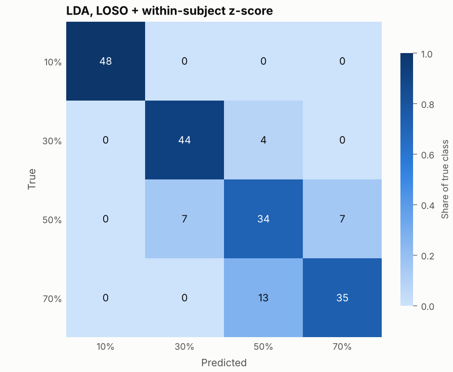
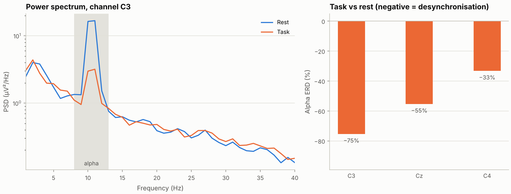

# biosigkit

**De gravações brutas de EMG / EEG / força a uma tabela de features organizada, uma acurácia honesta entre sujeitos e um banco SQL.**

[](https://github.com/juanbezerra1/biosigkit/actions/workflows/ci.yml)


*Read in English: [README.md](README.md)*

O biosigkit é um toolkit Python pequeno, tipado e testado para a parte pouco glamourosa dos projetos com
biossinais: limpar as gravações sempre do mesmo jeito, transformá-las em tabelas organizadas (*tidy*), validar
classificadores sem se enganar e guardar os resultados em um banco que se consulta com SQL. Vem com um gerador de
dados sintéticos e uma demonstração de ponta a ponta, então tudo aqui roda **sem nenhuma gravação real**.



*Coorte sintética: 8 sujeitos, 192 tentativas, 4 níveis de força (acaso = 25 %). Em uma divisão
aleatória, tentativas do mesmo sujeito caem no treino e no teste. Deixar sujeitos inteiros de fora é a estimativa
honesta, e padronizar (z-score) as features de cada sujeito remove as diferenças de ganho entre eles.*

## Problemas que ele ataca

- **A variabilidade entre sujeitos domina.** Posição do eletrodo, impedância da pele e esforço mudam a escala das
  features de EMG/EEG mais do que o efeito que você procura.
- **Divisões aleatórias treino/teste vazam informação.** Quando tentativas do mesmo sujeito ficam dos dois lados, o
  modelo aprende *quem* é o sujeito em vez de *o que* ele fez, e a acurácia fica otimista.
- **A interferência da rede elétrica muda entre gravações** (50 ou 60 Hz, harmônicos, intensidade). Ela precisa ser
  tratada igual para todos, e o que foi feito precisa ficar registrado.
- **Tabelas de features apodrecem.** Scripts mais planilhas não permitem consulta, auditoria nem junção com metadados.

## O que tem dentro

| Área | O que você ganha |
| --- | --- |
| Contêiner de sinal | `Signal` imutável (canais × amostras, `fs`, `t0`, metadados) com `crop`, `pick`, `to_frame`, `from_frame` |
| Filtragem | Butterworth de fase zero (passa-banda/baixas/altas), notch IIR, remoção de tendência, reamostragem polifásica racional |
| Pré-processamento | `PreprocessConfig` declarativo, `EMG_PRESET` / `EEG_PRESET`, **detecção automática de 50/60 Hz** (com harmônicos) que resiste a contrações fortes, proveniência em `signal.meta["preprocess"]` |
| EMG | Envelope linear, RMS móvel, normalização por %CVM, MAV / RMS / WL / ZC / SSC / VAR / iEMG / MNF / MDF, detecção de ativação por limiar |
| EEG | PSD de Welch, potência por banda, referência média comum, ERD %, rejeição de épocas por pico a pico |
| Força | Tempo na faixa, maior trecho contínuo na faixa, erro de rastreamento, estabilidade (CV) |
| Tabelas | Tabelas por janela e por tentativa com colunas `<canal>_<feature>`, rótulo por sobreposição, conversão longo/largo, resumos, validação |
| Aprendizado de máquina | LOSO, k-fold por grupo e (para contraste) k-fold ingênuo; normalização ajustada dentro de cada fold; z-score por sujeito; LDA / SVM / random forest / regressão logística; comparação de cenários |
| SQL | Esquema SQLite (sujeitos → gravações → segmentos → features), consultas parametrizadas, seis consultas didáticas (funções de janela, CTEs, gaps-and-islands...) |
| Linha de comando | `biosigkit demo \| features \| evaluate \| sql` |
| Dados sintéticos | EMG de controle de força com variabilidade entre sujeitos, deriva de ganho entre tentativas e interferência da rede; EEG com dessincronização alfa relacionada à tarefa |

## Instalação

```bash
git clone https://github.com/juanbezerra1/biosigkit
cd biosigkit
pip install -e ".[dev]"      # Python >= 3.10
```

## Início rápido

```python
import pandas as pd

from biosigkit import EMG_PRESET, compare_scenarios, make_cohort, preprocess, trial_feature_table
from biosigkit.tables import infer_feature_columns

# 1. A small simulated cohort: 6 subjects, 4 force levels (10/30/50/70 % MVC), 4 trials each.
cohort = make_cohort(n_subjects=6, trials_per_level=4, seed=1)

# 2. Preprocess every recording (detrend -> mains notch -> 20-450 Hz band-pass) and extract one
#    row of features per trial. The first second of every trial (the force ramp) is trimmed.
tables = []
for session in cohort:
    emg = preprocess(session.emg, EMG_PRESET)
    print(f"{session.subject}: notch applied at {emg.meta['preprocess']['notch_applied_hz']} Hz")
    tables.append(
        trial_feature_table(emg, session.events, trim_s=1.0, meta={"subject": session.subject})
    )
trials = pd.concat(tables, ignore_index=True)
features = infer_feature_columns(trials)
print(f"\n{len(trials)} trials x {len(features)} features, e.g. {features[:3]}\n")

# 3. Compare validation schemes. A random split can let the model recognise the subject
#    (optimistic); leaving whole subjects out (LOSO) is the honest estimate; z-scoring within
#    subject removes the scale differences between subjects.
results = compare_scenarios(trials, features, "label", "subject", models=("lda", "rf"))
print(results[["model", "scheme", "normalization", "accuracy"]].round(3).to_string(index=False))
```

Saída:

```text
S01: notch applied at [60.0, 120.0] Hz
S02: notch applied at [60.0, 120.0] Hz
S03: notch applied at [60.0, 120.0] Hz
S04: notch applied at [60.0, 120.0] Hz
S05: notch applied at [60.0, 120.0] Hz
S06: notch applied at [60.0, 120.0] Hz

96 trials x 10 features, e.g. ['emg1_mav', 'emg1_rms', 'emg1_wl']

model scheme normalization  accuracy
  lda  kfold          none     0.396
   rf  kfold          none     0.562
  lda   loso          none     0.417
   rf   loso          none     0.438
  lda   loso  within_group     0.885
   rf   loso  within_group     0.917
```

Com apenas 96 tentativas esses números são ruidosos (a divisão aleatória nem sempre fica acima do LOSO); o ponto é o
salto quando as features recebem z-score dentro de cada sujeito. O comando `demo` abaixo usa o dobro de tentativas.

Ou rode o pipeline inteiro pelo terminal (cerca de 10 segundos; gera relatório, figuras, CSVs e um banco de dados):

```bash
biosigkit demo --out demo_output
```

## O que a demonstração mostra

Classificação do nível de força (10 / 30 / 50 / 70 % de um máximo) a partir de features de EMG por tentativa.
Acurácia por esquema de validação, 192 tentativas de 8 sujeitos simulados:

| Modelo | Divisão aleatória (vaza) | Leave-one-subject-out | LOSO + z-score por sujeito |
| --- | ---: | ---: | ---: |
| LDA | 0.391 | 0.359 | **0.839** |
| Linear SVM | 0.573 | 0.484 | **0.833** |
| RBF SVM | 0.573 | 0.568 | **0.818** |
| Random forest | 0.646 | 0.604 | **0.818** |

- A divisão aleatória é mais otimista que deixar sujeitos de fora em todos os modelos (de 0.5 a
  8.9 pontos percentuais aqui, porque os sujeitos simulados diferem principalmente por um fator de ganho).
  Com dados reais a diferença pode ser bem maior; `tests/test_ml.py` constrói um caso extremo de propósito.
- O z-score por sujeito é o que faz a classificação entre sujeitos funcionar nesta simulação
  (+21 a +48 pontos sobre o LOSO simples).
- **Ressalva:** o z-score por sujeito usa as features *sem rótulo* do sujeito deixado de fora (na prática, um bloco de
  calibração). Ele é transdutivo; não leia como um modelo que nunca viu o sujeito novo.

Outros resultados da mesma execução (dados sintéticos, então verificam o código, não a fisiologia):

- Detecção de ativação por limiar: 192/192 contrações encontradas, 0 falsos positivos, latência mediana de início
  de 0.01 s.
- Interferência da rede (60 Hz e o harmônico) detectada em todos os sujeitos simulados.
- Dessincronização alfa simulada recuperada como C3 −75 %, Cz −55 %, C4 −33 %.
- Uma consulta SQL de gaps-and-islands recupera exatamente o número simulado de contrações a partir da tabela por janela.







## Decisões de projeto

- **Sinais imutáveis, proveniência registrada.** Toda operação devolve um novo `Signal`. O `preprocess` escreve o que
  fez (frequências de rede detectadas, taxas de amostragem) em `meta`, e o `register_recording` guarda isso como JSON junto dos dados.
- **Filtragem de fase zero.** O `sosfiltfilt` evita distorção de fase, importante para o tempo de início da ativação. O
  preço é a não causalidade: serve para análise offline, não para controle em tempo real.
- **Detecção de ruído da rede que sobrevive às contrações.** Usa um quantil baixo do espectrograma ao longo do tempo
  em vez da média: a interferência da rede é estacionária, os surtos de EMG não. Um teste roda a detecção em gravações
  simuladas com e sem interferência e exige zero falhas e zero falsos alarmes.
- **Tabelas organizadas com convenção de nomes.** As colunas são `<canal>_<feature>` e nomes de feature não podem ter
  sublinhado, então os formatos largo e longo convertem sem perdas.
- **Validação sem vazamento por padrão.** LOSO e k-fold por grupo garantem que nenhum sujeito aparece dos dois lados de
  uma divisão, e os normalizadores são ajustados dentro de cada fold de treino. O k-fold ingênuo existe só para medir o
  otimismo.
- **SQL como saída de primeira classe.** As features vão para uma tabela longa (`segment_id`, `channel`, `feature`,
  `value`), NaN vira `NULL`, valores são sempre passados como parâmetros (nunca colados no texto SQL), e o `biosigkit sql run`
  abre o banco somente para leitura.

## SQL

```text
subjects 1──* recordings 1──* segments 1──* features
                              (window | trial,  (channel, feature, value)
                               t_start, t_stop, label)
```

| Consulta | O que ela treina |
| --- | --- |
| `mean_rms_by_label` | `JOIN` de três tabelas, `GROUP BY`, funções de agregação |
| `within_subject_minmax` | CTEs, funções de janela (`MIN` / `MAX` / `PERCENT_RANK() OVER`), `WINDOW` nomeada, `NULLIF` |
| `activation_episodes` | o padrão gaps-and-islands: duas janelas `ROW_NUMBER()`, CTEs encadeadas |
| `top_trials_per_subject` | top-N por grupo: `ROW_NUMBER() OVER (PARTITION BY ...)` filtrado por uma CTE |
| `data_quality` | agregado de um agregado, `CASE`, sinalizadores de balanceamento de classes |
| `missing_values` | aritmética booleana em agregados (`SUM(value IS NULL)`), percentuais calculados |

```bash
biosigkit sql list
biosigkit sql show activation_episodes
biosigkit sql run demo_output/biosigkit_demo.sqlite --example top_trials_per_subject
biosigkit sql run demo_output/biosigkit_demo.sqlite -q "SELECT feature, COUNT(*) FROM features GROUP BY feature"
```

## Linha de comando

| Comando | Para quê |
| --- | --- |
| `biosigkit demo [--subjects N] [--trials-per-level N] [--seed S] [-o DIR]` | Pipeline completo em dados sintéticos: relatório, figuras, CSVs, banco SQLite |
| `biosigkit features SINAL.csv [--events EVENTOS.csv] [--mode window\|trial] [--kind emg\|eeg]` | Pré-processa uma gravação e escreve a tabela de features (`--fs` ou `--time-col` dá a taxa de amostragem) |
| `biosigkit evaluate FEATURES.csv [--model lda\|svm_rbf\|svm_linear\|rf\|logreg] [--scheme loso\|group_kfold\|kfold] [--normalize]` | Valida sem vazamento entre sujeitos e imprime métricas e matriz de confusão |
| `biosigkit sql list \| show NOME \| run BANCO (-e NOME \| -q "SELECT ...")` | SQL embutido e consultas livres |

CSVs de sinal têm uma coluna por canal; CSVs de eventos têm `onset`, `offset` e `label` (segundos).

## Estrutura do projeto

```text
src/biosigkit/
├── signals.py      contêiner Signal imutável
├── filters.py      passa-banda/baixas/altas, notch, detrend, resample
├── preprocess.py   PreprocessConfig, presets, detecção automática de ruído da rede
├── emg.py  eeg.py  force.py        features específicas de cada sinal
├── windowing.py    janelas deslizantes, tabelas de eventos, épocas
├── tables.py       tabelas de features, longo/largo, resumos
├── ml.py           validação cruzada sem vazamento, z-score por sujeito
├── storage.py      esquema SQLite, salvar/carregar, consultas parametrizadas
├── sql/            schema.sql e as seis consultas didáticas
├── synthetic.py    sessões e coortes simuladas
├── viz.py          figuras (API Figure do matplotlib, paleta segura para daltonismo)
└── demo.py  cli.py  __main__.py
tests/              suíte pytest, um arquivo por módulo
examples/           quickstart.py (o trecho acima)
docs/img/           figuras usadas neste README
```

## Desenvolvimento

```bash
pip install -e ".[dev]"
pytest --cov=biosigkit
ruff check . && ruff format --check .
mypy src
```

O CI roda os testes no Python 3.10 a 3.13, lint e tipos, e constrói o wheel e roda a demonstração em um ambiente
limpo. A suíte também passa com as versões mais antigas suportadas das dependências.

## Escopo e limitações

- Tudo aqui é **simulado**. Os números verificam que o código faz o que diz; não dizem nada sobre o desempenho de
  qualquer classificador em gravações reais.
- Não é uma ferramenta clínica nem um dispositivo médico.
- Apenas análise offline (filtros de fase zero são não causais).
- Não tenta substituir o [MNE-Python](https://mne.tools) (análise de EEG/MEG) nem o
  [NeuroKit2](https://neuropsychology.github.io/NeuroKit/) (processamento de sinais fisiológicos). Cobre um caminho
  mais estreito (gravação bruta, tabela organizada, validação honesta, SQL) em poucos milhares de linhas legíveis.
- Nenhum dado de participante deve entrar neste repositório; o `.gitignore` exclui formatos comuns de gravação.

## Licença

MIT, veja [LICENSE](LICENSE). Copyright (c) 2026 Juan de Oliveira Bezerra.
